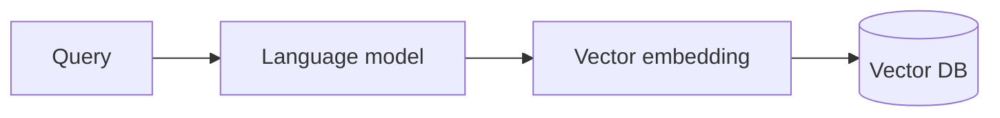

# 📅 Learning Log — 26 Nov 2026

**Topic:** RAG → Retrieval (Keyword Search & Semantic Search)
**Tags:** `#RAG` `#retrieval` `#TF-IDF` `#BM25` `#semantic-search` `#embeddings`

---

## 1. What / Why RAG?

RAG = **Retrieval-Augmented Generation**: the model first *retrieves* relevant documents, then *generates* an answer grounded in them. A big reason to use it is to reduce hallucinations.

### Techniques used to reduce hallucinations

1. **Data grounding**
2. **Prompt design**
3. **Model alignment**
4. **Decoding controls**
5. **Post-generation verification**

---

## 2. Retrieval

**Goal:** Find *which document is relevant* to the query.

- One way → **using keywords** → this is **keyword search**
- Keyword search ranks documents based on how frequently the keywords appear

```
Keyword search ──► Techniques ──┬──► TF-IDF
                                └──► BM25
```

---

## 3. TF-IDF vs BM25

| | **TF-IDF** | **BM25** |
|---|---|---|
| Full form | Term Frequency – Inverse Document Frequency | Best Matching 25 |
| What it is | Weighs words by how often they appear in a doc vs. across all docs | Probabilistic ranking algorithm |
| Library | `sklearn` → `TfidfVectorizer` | — |
| Use it for | Lightweight text analysis | Search engines |

### Difference — why & when to choose what?

- **Key difference: keyword saturation**
  - In TF-IDF, a word's score keeps growing the more times it repeats in a doc.
  - In BM25, the score *saturates*: after a few repeats, extra occurrences add very little. (BM25 also adjusts for document length.)
- So: **TF-IDF** → quick, simple text analysis. **BM25** → ranking results in search.

```python
from sklearn.feature_extraction.text import TfidfVectorizer

docs = ["RAG reduces hallucinations", "BM25 is used in search engines"]
vectorizer = TfidfVectorizer()
X = vectorizer.fit_transform(docs)          # matrix: documents × vocabulary
print(vectorizer.get_feature_names_out())
```

---

## 4. Semantic Search

- Based on **relevance & meaning** instead of just keywords
- Achieved through **embeddings** → text is converted into **vectors** (lists of numbers)
- **The closer two vectors are, the more similar their meaning**

### How semantic search works



> 📝 Note to self: documents are embedded and stored in the vector DB ahead of time; at search time the query is embedded the same way and compared against them.

### Measuring similarity

- **Dot product** is used to find the similarity between n-dimensional vectors
- We use **NumPy** for this

```python
import numpy as np

a = np.array([0.20, 0.80, 0.10])
b = np.array([0.25, 0.70, 0.05])

similarity = np.dot(a, b)   # higher = more similar
print(similarity)
```

> If the vectors are normalized (length 1), the dot product equals the **cosine similarity**.

---

## 🔑 Key Takeaways

1. RAG grounds the model's answers in retrieved documents, which helps reduce hallucinations.
2. Keyword search (TF-IDF, BM25) matches *words*; semantic search (embeddings) matches *meaning*.
3. BM25 beats plain TF-IDF for search mainly because of keyword saturation.

## ❓ Open Questions / To Explore

- [ ] What is **loop engineering**?
- [ ] Try BM25 in code (e.g., the `rank_bm25` library) and compare its results with TF-IDF on the same docs
- [ ] Which vector DBs are commonly used, and how do they differ?
