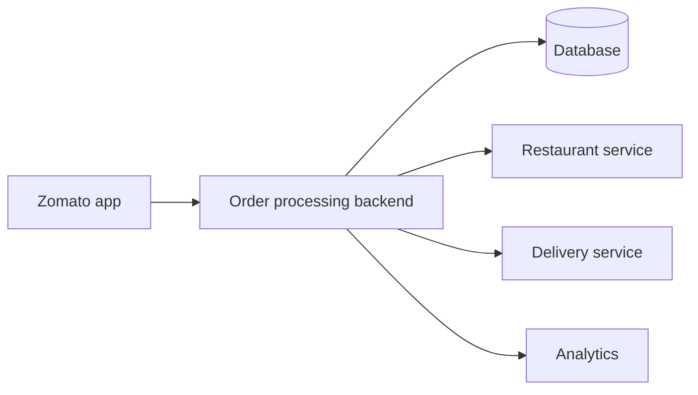
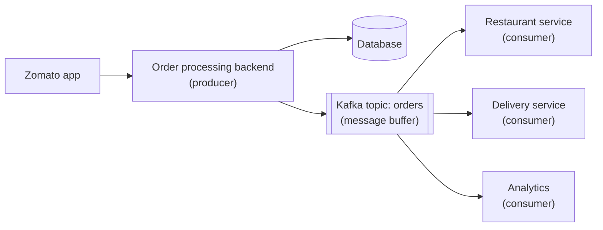
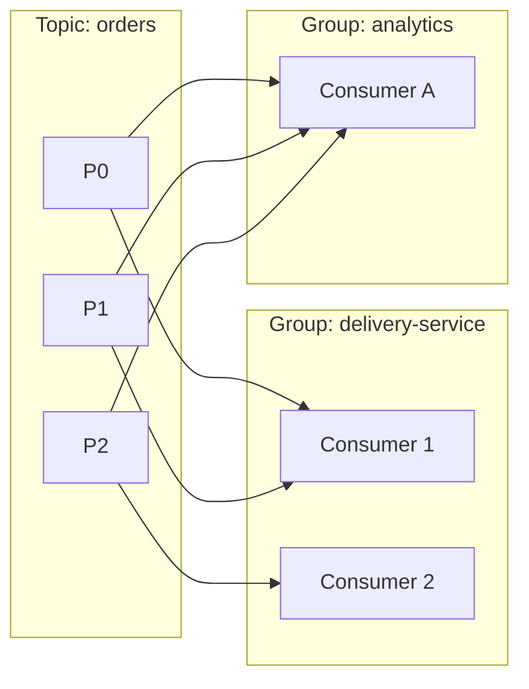

# Apache Kafka: Notes

*Written up from handwritten notes (27 Nov 2026), with extra sections for topics the notes list but don't explain.*

> Diagrams use Mermaid (renders in GitHub, Obsidian, VS Code and similar) or plain text.

---

## 1. What is Kafka?

**Apache Kafka** is a **distributed event streaming platform** built on a **partitioned log model**. It does three things:

1. **Real-time data capture:** it takes in streams of events (orders, clicks, payments, sensor readings) as they happen.
2. **Durable storage:** it writes events to disk and keeps copies on several machines, so data survives a server failure.
3. **Stream processing:** it lets apps process those events as they arrive.

Key points:
- It **handles and processes streaming data**: a continuous flow of small records, not one-off requests.
- It **can replay**: reading an event doesn't delete it, so consumers can go back and re-read old data.
- It is **distributed**: data is spread across many servers (brokers), so it scales beyond one machine.

> **Event** = a record that something happened, e.g. *"Order #1042 placed by user 77 at 10:05"*. It usually has a **key**, a **value**, a **timestamp** and optional **headers**.

---

## 2. Why Kafka? Traditional vs. new architecture (Zomato example)

### 2.1 Traditional architecture: tightly coupled and synchronous



The order backend calls every downstream service **directly** and **waits for each one to finish**.

Problems:
- **Tightly coupled:** the backend has to know about every service. Adding a new one (e.g. a loyalty-points service) means changing the backend code.
- **Synchronous:** the user's order is only as fast as the slowest service in the chain.
- **Fragile:** if the Delivery service is down or slow, order placement slows down or fails too.
- **No buffer for spikes:** at a dinner-time rush, every service gets hit at full rate at the same moment.

### 2.2 New architecture: Kafka as a message buffer



The backend writes **one event** ("order placed") to Kafka and moves on. Each service reads that event **when it is free**.

What this fixes:
- **Loosely coupled:** the backend doesn't know or care who reads the event. A new service just starts reading the topic, with no change to the backend.
- **Asynchronous:** the user gets a fast response. Downstream work happens in parallel.
- **Fault tolerant:** if Delivery is down for 5 minutes, its events wait safely in Kafka and get processed when it comes back.
- **Absorbs spikes:** Kafka buffers the rush and consumers work through it at their own pace.

> **Clarification on "delivers when consumers are free":** Kafka doesn't push messages. **Consumers pull** (poll) events from Kafka when they're ready. That's why a slow consumer never gets overwhelmed: it just falls behind and catches up later. How far behind it is gets called **consumer lag**.

---

## 3. Core building blocks

| Concept | One-line meaning |
|---|---|
| **Producer** | An app that **writes** events to Kafka (e.g. the order backend). |
| **Topic** | A named stream/category of events (e.g. `orders`, `payments`). Like a table name, but for a stream. |
| **Partition** | A topic is split into partitions. Each one is an **ordered, append-only log**. |
| **Offset** | The position number of a record inside a partition (0, 1, 2, …). |
| **Broker** | A Kafka **server** that stores partitions and serves reads/writes. |
| **Cluster** | A group of brokers working together. |
| **Consumer** | An app that **reads** events from topics. |
| **Consumer group** | A set of consumers that **share the work** of reading a topic. |
| **Retention** | How long Kafka keeps events before deleting them. |

Each one is explained below.

---

## 4. Topics, partitions and offsets: the partitioned log model

```
                 Topic: orders (split into partitions)
                 ─────────────────────────────────────
                    offset →  0   1   2   3   4   5
Producer      ──▶  P0  [ ][ ][ ][ ][ ][ ]  ──▶  Consumer 1
(web app)          P1  [ ][ ][ ][ ]        ──▶  Consumer 1
Producer      ──▶  P2  [ ][ ][ ][ ][ ]     ──▶  Consumer 2
(payments)
                       new records are appended on the right →
```

- A **topic** is split into **partitions** (P0, P1, P2).
- Each partition is a **log**: records are only ever **appended to the end**, never changed in place.
- Every record gets an **offset**, its position in that partition.
- **Order is guaranteed only within a partition**, not across the whole topic.

### Why split into partitions?
- **Scale:** different partitions can live on different brokers, so one topic can be bigger and faster than any single machine.
- **Parallelism:** each partition can be read by a different consumer at the same time.

### How does a producer choose a partition? (partition keys)
- **With a key** (e.g. `order_id` or `user_id`): Kafka hashes the key, and the **same key always goes to the same partition**. All events for one order therefore stay **in order**.
- **Without a key:** events are spread across partitions to balance the load.

> Example: use `order_id` as the key so "placed → accepted → picked up → delivered" for one order is always read in the right sequence.

---

## 5. Brokers and clusters *(listed in notes, not explained)*

- A **broker** is a single Kafka server. It stores some partitions on disk and handles producer writes and consumer reads.
- A **cluster** is several brokers working together. Partitions are spread across them.
- Clients connect to any broker (through `bootstrap.servers`) and discover where every partition lives.

### Cluster metadata: ZooKeeper → KRaft
A cluster needs to keep track of which brokers are alive, where each partition lives, and who leads it.
- **Older Kafka (≤ 3.x)** used a separate system called **Apache ZooKeeper** for this.
- **Kafka 4.0 (released March 2025) removed ZooKeeper completely.** Kafka now uses **KRaft**, its own built-in Raft-based consensus protocol. There is one system to run instead of two.

> If you read an older tutorial that says "start ZooKeeper first", it's out of date for Kafka 4.x.

---

## 6. Replication: how Kafka stays durable *(unexplained topic)*

Each partition is **copied to several brokers**. The number of copies is the **replication factor** (commonly 3).

```
              Broker 1          Broker 2          Broker 3
Partition 0   LEADER            follower          follower
Partition 1   follower          LEADER            follower
Partition 2   follower          follower          LEADER
```

- **Leader:** the one copy that handles all reads and writes for that partition.
- **Followers:** keep copying the leader's data.
- **ISR (in-sync replicas):** the followers that are fully caught up.
- If a leader's broker dies, an in-sync follower is **automatically promoted** to leader. No data is lost and clients carry on.

### Producer `acks` setting: speed vs. safety
| `acks` | Producer waits for… | Trade-off |
|---|---|---|
| `0` | Nothing | Fastest. Messages can be lost. |
| `1` | Leader only | Lost if the leader dies before followers copy it. |
| `all` | All in-sync replicas | Safest. Slightly slower. The default in modern Kafka. |

---

## 7. Consumers and consumer groups *(how Kafka combines queuing + pub/sub)*

The notes say Kafka **combines two messaging models**. Consumer groups are how it does that.

| Model | How it works | Weakness on its own |
|---|---|---|
| **Queuing** | Each message goes to **one** worker. Work is shared. | Only one subscriber can get each message. |
| **Publish/Subscribe** | **Every** subscriber gets **every** message. | Can't split work among workers. |

**Kafka's answer:**
- **Within one consumer group, it behaves like a queue.** Each partition is assigned to exactly one consumer in the group, so the group splits the work.
- **Across different groups, it behaves like pub/sub.** Every group gets the full stream independently.



Here `delivery-service` splits the work (queue behaviour), while `analytics` independently receives *everything* (pub/sub behaviour).

### Rules worth remembering
- **Max useful consumers in a group = number of partitions.** With 3 partitions:
  - 1 consumer → reads all 3
  - 2 consumers → one reads 2, the other reads 1
  - 3 consumers → one each
  - 4 consumers → **one sits idle**
- **Rebalancing:** when a consumer joins, leaves or crashes, Kafka reassigns partitions among the remaining ones automatically.

---

## 8. Offsets, commits and replay *(the "can replay" point)*

- Kafka **does not delete a message when it's read**. Each consumer group just **remembers its position** (its **committed offset**) for each partition.
- If a consumer restarts, it resumes from its last committed offset.
- **Replay:** a consumer can **reset its offset** to an earlier point (or to the beginning) and re-read history, as long as the data is still within retention.

Why replay is useful:
- Fixing a bug in a consumer and **reprocessing** past events.
- Spinning up a **new service** that needs to build its state from historical events.
- Recovering after a crash without losing work.

> Compare RabbitMQ: once a message is consumed and acknowledged, it's gone.

---

## 9. Retention *(listed in notes, not explained)*

Retention decides **how long Kafka keeps data**, whether or not anyone has read it.

- **Time-based:** e.g. keep 7 days (`retention.ms`). Kafka's default is 7 days.
- **Size-based:** e.g. keep up to 100 GB per partition (`retention.bytes`).
- **Log compaction** (alternative policy): instead of deleting by age, keep **only the latest value for each key**. Useful for "current state" topics, e.g. the latest address for each user.

Retention is set **per topic**, so `clickstream` might keep 1 day while `orders` keeps 30 days.

---

## 10. Delivery guarantees *(unexplained topic)*

| Guarantee | Meaning | Risk |
|---|---|---|
| **At-most-once** | Each message is processed 0 or 1 times. | Messages can be **lost**. |
| **At-least-once** | Each message is processed 1 or more times. | **Duplicates** possible. Most common setup. |
| **Exactly-once** | Each message affects the result exactly once. | Needs idempotent producers + transactions. More overhead. |

The practical rule with at-least-once: make consumers **idempotent**, so processing the same event twice has no extra effect (e.g. check whether `order_id` was already handled).

---

## 11. The four Kafka APIs *(unexplained topic)*

| API | What it does | Example |
|---|---|---|
| **Producer API** | Write events to topics | Order backend publishes "order placed" |
| **Consumer API** | Read and process events from topics | Delivery service reads new orders |
| **Streams API** | Turn input topics into output topics (filter, join, aggregate) | Raw orders → "orders per city per minute" |
| **Connect API** | Ready-made connectors that move data between Kafka and other systems, with no custom code | Stream DB changes into Kafka, or Kafka into S3 |

---

## 12. Kafka vs. RabbitMQ *(unexplained topic)*

| Aspect | Apache Kafka | RabbitMQ |
|---|---|---|
| Model | Partitioned log (queue + pub/sub) | Traditional message queue (broker) |
| After a message is read | **Kept** until retention expires | **Deleted** once consumed |
| Replay | Yes | No |
| Ordering | Guaranteed per partition | Queue order; competing consumers split it |
| Scaling | Add partitions/brokers | Add consumers per queue |
| Throughput | Very high (millions of events/sec) | High, but lower for massive streams |
| Protocol | Own binary protocol over TCP | AMQP (+ MQTT, STOMP via plugins) |
| Best for | Event streams, pipelines, many readers of the same data | Task queues, complex routing, request/reply |

**Rule of thumb:** use RabbitMQ to **hand tasks to workers**. Use Kafka when **many systems need the same stream of events** or you need **history and replay**.

---

## 13. Real-world use cases

### 13.1 Netflix
- Netflix's **Keystone** platform is a real-time pipeline that carries events from its microservices (what you play, pause, search, errors, device metrics) to analytics and monitoring systems.
- It's **fronted by Kafka**. By 2016 Netflix was running **36 Kafka clusters handling 700+ billion messages a day**, and it later grew to around **100 Kafka clusters moving about 10 PB a day**.
- Used for recommendations, A/B test analysis, operational monitoring and personalisation.

### 13.2 Autonomous driving vehicles
- A self-driving fleet produces constant streams of **sensor and telemetry data** (GPS, speed, camera/LiDAR summaries, vehicle health).
- Kafka works as the **ingestion backbone**. Vehicles (or edge gateways) produce events, and several consumers use the same stream: real-time fleet monitoring, alerting on faults, map updates, and storing data for **training ML models**.
- Replay matters here: engineers can **re-run past drives' data** through new models or analysis.

### 13.3 Other common uses
- **Food delivery / e-commerce** (the Zomato example): order events fan out to restaurant, delivery, payments, notifications and analytics.
- **Ride-hailing:** live driver locations, trip events, surge pricing.
- **Banking:** real-time fraud detection on card transactions.
- **Log and metrics aggregation** from thousands of servers.
- **Change data capture (CDC):** streaming every database change into a data lake or search index.
- **Origin:** Kafka was originally built at **LinkedIn** to handle activity streams, then open-sourced through Apache.

---

## 14. Running Kafka on AWS

- **Self-managed:** install and operate Kafka yourself on EC2. Full control, full operational burden.
- **Amazon MSK (Managed Streaming for Apache Kafka):** AWS runs the brokers, patching, replication and scaling. You just create topics and connect producers/consumers.

---

## 15. Quick revision

- Kafka = **distributed event streaming platform**, **partitioned log model**.
- **Producer → Topic (partitions) on Brokers → Consumer groups.**
- Partition = **ordered, append-only log**. Record position = **offset**.
- **Order guaranteed only within a partition.** Use a **key** to keep related events together.
- **Same group = queue** (work split). **Different groups = pub/sub** (everyone gets everything).
- Max parallel consumers in a group = **number of partitions**.
- Messages are **kept until retention expires**, so consumers **can replay**.
- **Replication factor** (often 3) + **leader/follower** = durability and fault tolerance.
- **Kafka 4.0+ uses KRaft**, with no ZooKeeper.
- Solves the **tightly coupled, synchronous** problem of traditional architectures by acting as a **buffer** between services.

---

## Sources
- [AWS: What is Apache Kafka?](https://aws.amazon.com/what-is/apache-kafka/)
- [Apache Kafka 4.0 release announcement](https://kafka.apache.org/blog/2025/03/18/apache-kafka-4.0.0-release-announcement/)
- [Kafka 4.x upgrade notes (ZooKeeper removal)](https://kafka.apache.org/41/getting-started/upgrade/)
- [InfoQ: Netflix Keystone real-time stream processing platform](https://www.infoq.com/news/2018/09/Netflix-Keystone-Real-Time-Proc)
- [Alibaba Cloud blog: Evolving Netflix Keystone](https://www.alibabacloud.com/blog/596679)
